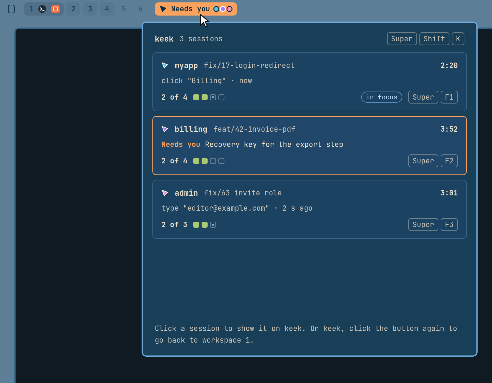

# keek for the Omarchy bar

See your [keek](https://github.com/radimsem/keek) Agent Sessions from the Omarchy bar, and get to the one that needs you in one click.

<p align="center">
  
</p>

## What the button shows

The button appears while at least one session is on the keek workspace. With no session open, it takes no space in the bar.

| Button | What it means |
| --- | --- |
|  | **Sessions open.** One dot per session, in its cursor colour. A session that ended shows as a ring until you dismiss its card. Click to show the keek workspace. |
|  | **On keek.** Highlighted like the active workspace. Click again to go back to where you came from. |
|  | **A session needs you.** Orange while a Help Request waits. A white ring marks the waiting session. Click to show it. |

The images are drawn from the widget's design, on Omarchy's Cumulus theme. The widget takes its colours from your theme.

## The session list

Hover the button to list each session: Project, branch, elapsed time, state, Checks and its Super F key. Click a row to show that session on keek.

While you are in control of a session (a Takeover, running or paused), the button and the list do nothing until you press Done, and the list's rows dim.

## Install

You need Omarchy 4 with the Quickshell bar, and keek, whose daemon publishes the state this widget reads.

```sh
omarchy plugin add https://github.com/radimsem/omarchy-keek --enable
```

To update, then load the new code:

```sh
omarchy plugin update radimsem.keek
omarchy restart shell
```

To remove it:

```sh
omarchy plugin remove radimsem.keek
```

## Shortcuts

keek ships no keybinding. The list names a shortcut only when `hyprctl binds -j` lists it, so it never shows a key that does nothing:

- **Super+Shift+K** in the list's header, for a bind that switches to `name:keek`.
- **Super F1 to F4** on each row, for the binds that emit `keek-show <n>`, as keek's `docs/viewer.md` describes. They show only while `keek` is the active workspace, the only place those binds act.

The widget reads your binds when the shell starts and each time Hyprland reloads its config. A bind written in Lua shows in `hyprctl binds -j` without its action, so for those the widget trusts the key and its modifiers.

## How it reads keek

keek's daemon writes `$XDG_RUNTIME_DIR/keek/bar.json` when a session opens, changes state, ends or is closed, and on each Action, Check mark and change of focus. The widget watches the file and redraws when it changes. It never polls.

- keek writes a temporary file and renames it over the old one, so the widget never reads half a file.
- An ended session keeps its entry until you dismiss its card on keek. keek removes the file when no session is left.
- The file holds a schema `version` and one entry per session. This widget reads version 1, and hides itself when it finds no file, no sessions or a version it doesn't know. keek documents the fields in its `docs/viewer.md`, under Bar Widget.

To know where to go back to, the widget records each workspace that gains focus, on any monitor. It skips `keek`, `keek-rail` and special workspaces, so going back never lands on the rail. If it has recorded none, for example after the shell restarts on `keek`, going back lands on workspace 1.

## Development

The logic lives in `Model.js` and runs under node:

```sh
node tests/model.test.js
```

Check the manifest before publishing:

```sh
omarchy plugin validate .
```

`CHECKLIST.md` lists the checks to run by hand on a live desktop.

## License

MIT
